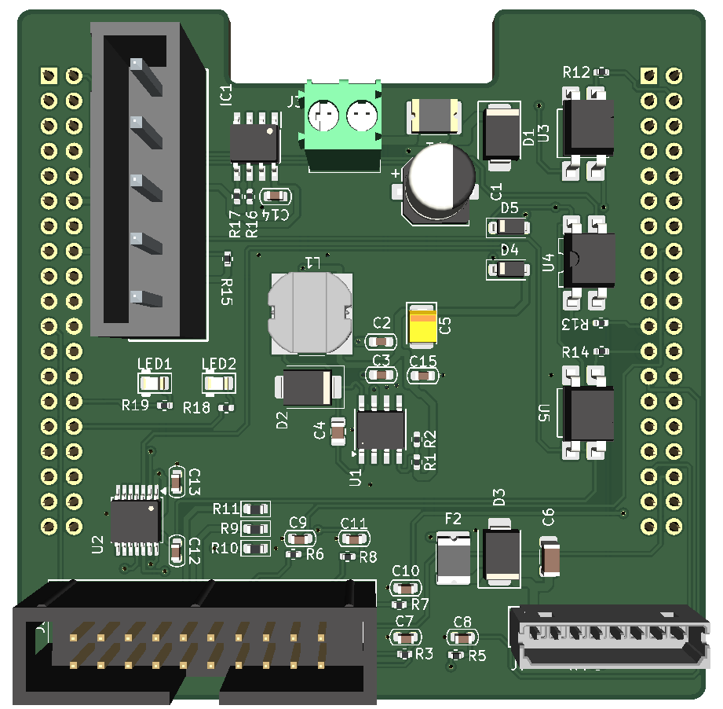

<a id="readme-top"></a>

<!-- PROJECT SHIELDS -->
[![License][license-shield]][license-url][![Platform][platform-shield]][platform-url][![Toolchain][toolchain-shield]][toolchain-url][![Verified][verified-shield]][verified-url]

<!-- PROJECT LOGO -->
<br />
<div align="center">
  <h3 align="center">ELS_Interface — NUCLEO-G474RE Shield</h3>

  <p align="center">
    Carrier board for the STM32G474RE (NUCLEO-G474RE) that puts on a single
    70 × 70 mm PCB the field interface of an electronic machine controller:
    12 V → 5 V buck supply, serial display connector, 2×10 IDC field I/O with
    level shifting and opto-isolated outputs, I²C EEPROM and two debug LEDs.
    <br />
    <a href="#documentation"><strong>See the Documentation »</strong></a>
    <br />
    <br />
    <a href="#about-the-project">About</a>
    &middot;
    <a href="#getting-started">Getting Started</a>
    &middot;
    <a href="#verification">Verification</a>
    &middot;
    <a href="#production-files">Production Files</a>
  </p>
</div>

<!-- TABLE OF CONTENTS -->
<details>
  <summary>Table of Contents</summary>
  <ol>
    <li>
      <a href="#about-the-project">About The Project</a>
      <ul>
        <li><a href="#main-features">Main Features</a></li>
        <li><a href="#built-with">Built With</a></li>
      </ul>
    </li>
    <li>
      <a href="#getting-started">Getting Started</a>
      <ul>
        <li><a href="#prerequisites">Prerequisites</a></li>
        <li><a href="#installation">Installation</a></li>
      </ul>
    </li>
    <li><a href="#documentation">Documentation</a></li>
    <li><a href="#usage">Usage</a></li>
    <li><a href="#verification">Verification</a></li>
    <li><a href="#production-files">Production Files</a></li>
    <li><a href="#repository-structure">Repository Structure</a></li>
    <li><a href="#known-issues--limitations">Known Issues & Limitations</a></li>
    <li><a href="#contributing">Contributing</a></li>
    <li><a href="#license">License</a></li>
    <li><a href="#acknowledgments">Acknowledgments</a></li>
  </ol>
</details>

<!-- ABOUT THE PROJECT -->
## About The Project



**ELS_Interface** is a KiCad shield for the **NUCLEO-G474RE**
(STMicroelectronics **STM32G474RET6**, LQFP64). It plugs onto the two morpho
headers of the Nucleo board and carries the machine-side interface of an
electronic lead-screw (ELS) controller.

The board is a **2-layer design**, 70 × 70 mm, 1 oz copper, routed and
**DRC-clean** (0 active violations, 0 unconnected nets), with a fully filled
copper pour on both sides.

The 12 V field supply enters on a screw terminal, is protected and stepped
down to 5 V by a **TPS5430** buck converter; the 5 V rail of the shield can be
fed either from that buck or from the Nucleo USB supply through a **diode-OR**
(D4 / D5), so the board can be brought up on the bench without the 12 V
connected. The Nucleo itself is fed on the **E5V** pin (CN7-6) directly from
the buck, which keeps that pin inside the 4.75–5.25 V range specified by ST
(UM2505).

> [!WARNING]
> Hobbyist / educational project, **not certified**. The board works on 12 V
> and switches field signals through optocouplers, but no functional-safety
> claim is made: verify every interface against your machine before use.
> <br>
> This project was developed with the support of artificial intelligence
> tools — see [Verification](#verification).

### Main Features

| Item | Value |
|---|---|
| Board size | **70 × 70 mm**, 2 layers, 1 oz copper |
| MCU board | NUCLEO-G474RE (STM32G474RET6) via J1 (CN7) + J2 (CN10), 2×19, 2.54 mm |
| Supply input | **12 V DC** on J3 (2-pole screw terminal), protected by F1 polyfuse + TVS D1 |
| 5 V generation | **TPS5430** buck, 5 V / up to 3 A, L1 22 µH, C5 220 µF |
| Supply selection | **diode-OR D4/D5** (12 V rail vs. USB) on the shield 5 V rail |
| MCU supply | E5V (CN7-6), 5.00 V direct, jumper **JP5 = 5-6** on the Nucleo |
| Display | **J7** — 8-pin 2.00 mm (DWIN DMG10600C101), 12 V + TTL UART |
| Field I/O | **J5** — IDC 2×10, level-shifted by **TXB0104** |
| Isolated outputs | **3 × PC817** optocouplers → **J8** (5-pole screw terminal) |
| Memory | **M24M01E** 1 Mbit I²C EEPROM (IC1) |
| Debug LEDs | LED1 green on **PA0**, LED2 red on **PA1**, 0402 resistors |
| Assembly | **56 components**, JLCPCB-ready (BOM + CPL + LCSC codes) |

### Built With

* [![KiCad][kicad-shield]][kicad-url]
* [![STMicroelectronics][st-shield]][st-url]
* [Electra 6.x](https://www.layouteditor.com/) — autorouter used for the initial PCB routing

<p align="right">(<a href="#readme-top">back to top</a>)</p>

<!-- GETTING STARTED -->
## Getting Started

### Prerequisites

* **KiCad 10** (developed and verified with **10.0.6**).
* No external libraries are needed: symbols, footprints and 3D models are
  stored inside `library/` and referenced with `${KIPRJMOD}`.

### Installation

1. Clone the repository:
   ```sh
   git clone https://github.com/Clumsy-old-boy/ELS_Interface.git
   ```
2. Open `ELS_Interface.kicad_pro` with KiCad 10.
3. Check that the library tables are loaded: *Preferences → Manage Symbol
   Libraries* and *Manage Footprint Libraries* must show `ELS_Custom`,
   `User_Library`, `User_Footprints` and the `PCM_*_AKL` entries, all with
   `${KIPRJMOD}` paths.

<p align="right">(<a href="#readme-top">back to top</a>)</p>

<!-- DOCUMENTATION -->
## Documentation

| Document | File | Description |
|---|---|---|
| Usage | [`docs/USAGE.md`](docs/USAGE.md) | Supply, connectors, LEDs, Nucleo jumper JP5 |
| Configuration | [`docs/CONFIGURATION.md`](docs/CONFIGURATION.md) | Pinout, connected components, logic levels, connector map |
| Test procedure | [`docs/TEST_PROCEDURE.md`](docs/TEST_PROCEDURE.md) | Power-up, LED, opto, display and IDC tests |
| User guide (PDF) | [`docs/USAGE.pdf`](docs/USAGE.pdf) | Printable user guide, 8 pages |
| Configuration (PDF) | [`docs/CONFIGURATION.pdf`](docs/CONFIGURATION.pdf) | Printable hardware configuration, 8 pages |
| Test procedure (PDF) | [`docs/TEST_PROCEDURE.pdf`](docs/TEST_PROCEDURE.pdf) | Printable bench checklist, 11 pages |
| Schematic | [`docs/ELS_Interface_schematics.pdf`](docs/ELS_Interface_schematics.pdf) | Full schematic, single A4 sheet, with title block and revision |
| PCB layout | [`docs/pcb.pdf`](docs/pcb.pdf) | Top view with all **55** reference designators and bottom view with the two morpho sockets (J1/J2) — 2 pages |
| Interactive BOM | [`docs/ELS_Interface_ibom.html`](docs/ELS_Interface_ibom.html) | Interactive assembly drawing (iBOM), generated with InteractiveHtmlBom |
| 3D render | [`docs/ELS_Interface_board.png`](docs/ELS_Interface_board.png) | Top 3D view of the assembled board, transparent background |

<p align="right">(<a href="#readme-top">back to top</a>)</p>

<!-- USAGE -->
## Usage

Quick start:

1. Set **JP5 on the Nucleo to pins 5-6 (`E5V`)** if the board supplies the
   Nucleo from 12 V.
2. Connect **12 V** to `J3` (pin 1 = +12 V, pin 2 = GND).
3. The **LED1 (green)** and **LED2 (red)** are driven by PA0 and PA1 of the
   firmware; they are debug indicators, not power indicators.
4. The shield 5 V rail is taken from the buck when 12 V is present, or from
   USB (through D5) when the board is used on the bench.

Full details: [`docs/USAGE.md`](docs/USAGE.md).

<p align="right">(<a href="#readme-top">back to top</a>)</p>

<!-- VERIFICATION -->
## Verification

The schematic and the PCB were verified with the **`kicad-mcp-pro`** MCP
server (KiCad 10.0.6) and with **`kicad-cli`**. The checks below were run on
the exact files contained in this repository.

| Check | Tool | Result |
|---|---|---|
| **ERC** — Electrical Rules Check | `kicad-mcp-pro` / `kicad-cli` | **0 violations** |
| **DRC** — Design Rules Check incl. custom JLCPCB rules | `kicad-mcp-pro` / `kicad-cli` | **0 active violations**, **0 unconnected items** |
| **Netlist** export | `kicad-cli sch export netlist` | completed, **56 components** |
| **Schematic ↔ PCB parity** | `kicad-mcp-pro` (`validate_footprints_vs_schematic`) | **56 refs = 56 refs**, 0 missing in both directions |
| **Connectivity** | `kicad-mcp-pro` (`pcb_get_ratsnest`) | **0 unconnected nets** |
| **DFM (JLCPCB)** | measurement on the `.kicad_pcb` | 2 layers · min track 0.25 mm · via 0.40/0.80 mm · min PTH 0.30 mm · 0 silk-to-pad violations |

> [!NOTE]
> Two DRC items are **excluded in the project** on purpose and are therefore
> not counted as active violations:
> `U1` *footprint type mismatch* (the SO-PowerPAD footprint of the TPS5430 has
> thermal vias, which the checker reports as an SMD/through-hole mismatch) and
> `F1` *footprint differs from the library copy* (a locally adjusted polyfuse
> footprint, already reflected in the Gerber files).

<p align="right">(<a href="#readme-top">back to top</a>)</p>

<!-- PRODUCTION -->
## Production Files

Everything needed to order the PCB and the SMT assembly at **JLCPCB**:

| File | Content |
|---|---|
| [`production/GERBER-ELS_Interface.zip`](jlcpcb/production_files/GERBER-ELS_Interface.zip) | Gerber (9 layers) + PTH / NPTH drill files |
| [`production/BOM-ELS_Interface.csv`](jlcpcb/production_files/BOM-ELS_Interface.csv) | Bill of materials with **LCSC part numbers** (50 components) |
| [`production/CPL-ELS_Interface.csv`](jlcpcb/production_files/CPL-ELS_Interface.csv) | Component placement (designator, X, Y, rotation, layer) |

Manufacturing rules matching JLCPCB 2-layer / 1 oz capability are in
[`ELS_Interface.kicad_dru`](ELS_Interface.kicad_dru).

> [!IMPORTANT]
> The through-hole connectors (J1, J2, J3, J5, J7, J8) are **excluded from
> the BOM and CPL** on purpose: they are not assembled by JLCPCB and must be
> soldered by hand.

<p align="right">(<a href="#readme-top">back to top</a>)</p>

<!-- REPOSITORY STRUCTURE -->
## Repository Structure

```
ELS_Interface/
├── ELS_Interface.kicad_pro      KiCad project
├── ELS_Interface.kicad_sch      Schematic
├── ELS_Interface.kicad_pcb      PCB, routed and DRC-clean
├── ELS_Interface.kicad_dru      Custom DRC rules for JLCPCB (2 layers, 1 oz)
├── fp-lib-table                 Footprint library table (${KIPRJMOD})
├── sym-lib-table                Symbol library table (${KIPRJMOD})
├── library/                     Project libraries and 3D models
│   ├── ELS_Custom.kicad_sym     Project-specific symbols
│   ├── ELS_Custom.pretty/       Project-specific footprints
│   ├── User_Library.kicad_sym   Power symbols (E5V, V_5V_SHIELD)
│   ├── User_Footprints.pretty/  Extra footprints (SOIC-8)
│   ├── *_AKL.kicad_sym          Alternate KiCad Library (vendored)
│   ├── *_AKL.pretty/            Alternate KiCad Library footprints (vendored)
│   └── 3d/                      STEP models used by the board
├── docs/                        PDF schematic, PCB view, iBOM and guides
└── jlcpcb/production_files/     Gerber ZIP, BOM, CPL — ready for JLCPCB
```

<p align="right">(<a href="#readme-top">back to top</a>)</p>

<!-- KNOWN ISSUES -->
### Known Issues & Limitations

- **Nucleo jumper JP5 must be set correctly**: `5-6` (E5V) when the board
  supplies the Nucleo, `1-2` (STLK) when the Nucleo is powered from USB.
- **Through-hole connectors are not assembled** by the SMT service; the
  40-pin morpho headers (J1/J2) and J3/J5/J7/J8 must be soldered by hand.
- **I²C3 pin mapping**: the `.ioc` enables I2C3 with custom timing but does not
  assign SCL/SDA; on the board the EEPROM is wired to **PC8/PC11** — confirm
  the mapping in CubeMX before generating the firmware.
- The **firmware is not included** in this repository: it lives in a separate
  STM32CubeMX/Keil project.
- The routing scripts used during development (Electra `.do` files and the
  Specctra `.dsn`) are not distributed with the repository.

<p align="right">(<a href="#readme-top">back to top</a>)</p>

<!-- CONTRIBUTING -->
## Contributing

1. Fork the Project
2. Create your Feature Branch (`git checkout -b feature/NewFeature`)
3. Commit your Changes (`git commit -m 'Add NewFeature'`)
4. Push to the Branch (`git push origin feature/NewFeature`)
5. Open a Pull Request

<p align="right">(<a href="#readme-top">back to top</a>)</p>

<!-- LICENSE -->
## License

Distributed under the **MIT** license. See [`LICENSE`](LICENSE) for the full text.

<p align="right">(<a href="#readme-top">back to top</a>)</p>

<!-- ACKNOWLEDGMENTS -->
## Acknowledgments

* [STMicroelectronics — STM32G4 Series](https://www.st.com/en/microcontrollers-microprocessors/stm32g4-series.html)
* [NUCLEO-G474RE user manual (UM2505)](https://www.st.com/resource/en/user_manual/um2505-stm32g4-nucleo64-boards-mb1367-stmicroelectronics.pdf)
* [JLCPCB PCB capabilities](https://jlcpcb.com/capabilities/pcb-capabilities)
* [kicad-druid — JLCPCB design rules for KiCad](https://github.com/Cimos/kicad-druid)
* [Best-README-Template](https://github.com/othneildrew/Best-README-Template) — structure of this README
* This project was developed with the support of artificial intelligence tools.

<p align="right">(<a href="#readme-top">back to top</a>)</p>

<!-- MARKDOWN LINKS & IMAGES -->
[license-shield]: https://img.shields.io/badge/license-MIT-yellow.svg?style=for-the-badge
[license-url]: LICENSE
[platform-shield]: https://img.shields.io/badge/MCU-STM32G474RE-03234B?style=for-the-badge
[platform-url]: https://www.st.com/en/microcontrollers-microprocessors/stm32g474re.html
[toolchain-shield]: https://img.shields.io/badge/toolchain-KiCad%2010-1C6BB0?style=for-the-badge
[toolchain-url]: https://www.kicad.org/
[verified-shield]: https://img.shields.io/badge/ERC%200%20%7C%20DRC%200-passing-brightgreen?style=for-the-badge
[verified-url]: #verification
[kicad-shield]: https://img.shields.io/badge/KiCad-10.0.6-1C6BB0?style=for-the-badge
[kicad-url]: https://www.kicad.org/
[st-shield]: https://img.shields.io/badge/STMicroelectronics-STM32G4-03234B?style=for-the-badge
[st-url]: https://www.st.com/en/microcontrollers-microprocessors/stm32g4-series.html